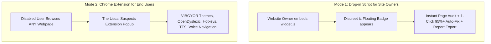

# The Usual Suspects - Universal Web Accessibility Layer for Any Website
### Hackathon Problem Statement 1.4: Universal Web Accessibility Layer

> **Problem:** Most websites fail basic accessibility checks, excluding visually impaired, dyslexic, and motor-impaired users.  
> **Target Users:** Small businesses, public-service portals, users with disabilities.  
> **Approach:** Dual-deployment accessibility solution:
> 1. **Drop-in JavaScript Widget (`widget.js`)**: A 1-line script for small business and public portal owners.
> 2. **Chrome Extension (Manifest V3)**: For users with disabilities to navigate any site across the web.
> **Bonus Twist:** One-click accessibility score compliance report for site owners.

---

## 🚀 Dual-Delivery Architecture



---

## ✨ Complete Feature Breakdown

### 1. 🌈 VIBGYOR & High-Contrast Visual Accommodation Engine
* **Full 7-Color Rainbow Spectrum**: Violet (`#8B00FF`), Indigo (`#4B0082`), Blue (`#0000FF`), Green (`#00FF00`), Yellow (`#FFFF00`), Orange (`#FF7F00`), Red (`#FF0000`).
* **Special Accessibility Modes**:
  * **Black High-Contrast**: Deep black background (`#000000`) with crisp high-contrast text (`#E0E0E0`).
  * **White Mode**: High-luminance white mode (`#FFFFFF`) with dark readable text (`#121212`).
  * **🌙 Dark / Night Owl Mode**: Low-strain dark theme (`#121212`) with neon green readability focus (`#00E676`).
  * **↺ 1-Click Reset**: Restores natural site styling.

### 2. 🛡️ Real-Time WCAG 2.1 AA Audit Scanner
* Evaluates active webpage DOM across 5 core categories (100 points total):
  * **🖼️ Non-Text Content (WCAG 1.1.1):** Checks image `alt` attributes and ARIA roles.
  * **📑 Headings & Landmarks (WCAG 1.3.1):** Verifies single `<h1>`, checks heading order, and detects landmark roles (`<main>`, `<nav>`).
  * **🏷️ Input & Control Identification (WCAG 4.1.2 & 3.3.2):** Validates accessible form labels and button names.
  * **🔍 Text Scaling & Zoom (WCAG 1.4.4):** Flags viewport zoom blocks (`user-scalable=no`, `maximum-scale=1.0`).
  * **♿ Screen Reader Readiness (WCAG 3.1.1):** Checks `<html lang="...">` pronunciation attributes and table headers.

### 3. ⚡ One-Click Auto-Fix (Boost to 95%+)
* Dynamically patches all detected accessibility violations in the live DOM in under 1 second:
  * Injects descriptive `alt` and `aria-label` tags into images from file metadata.
  * Removes pinch-to-zoom viewport restrictions and enables scaling up to 5x.
  * Generates accessible labels for input fields and icon buttons.
  * Injects accessible primary `<h1>` and `role="main"` landmarks.
  * Sets correct `lang` attribute for screen reader speech engines.

### 4. 📄 Executive Site Owner Compliance Report (The Bonus Twist)
* Generates a printable, client-ready **Accessibility Compliance Certificate (HTML / Print to PDF)** with:
  * Domain URL, timestamp, overall score (0–100), and Grade (A/B/C/F).
  * WCAG 2.1 AA checklist with Pass/Fail status for every metric.
  * Certified stamp for small businesses, public portals, and regulatory compliance.

### 5. 🔤 Dyslexia Typography Engine
* **OpenDyslexic-Regular**: True heavy-bottom font that anchors letters against flipping or rotation.
* **OpenDyslexic-Bold**: True vector bolding preventing browser faux-bold blurring.
* Custom word-spacing (`0.28em`), letter-spacing (`0.12em`), and line-height (`2.0`).

### 6. ⚡ Bionic Reading Engine
* Boldens first-half fixation points of words to guide visual focus and increase reading speed for ADHD and neurodiverse readers.

### 7. 🎯 Motor-Impaired Keyboard Navigation & Focus Rings
* **High-Visibility Focus Rings**: Injects glowing 3.5px orange focus indicators (`:focus-visible`) for easy tab navigation without a mouse.
* **Skip to Main Content Link**: Keyboard-accessible shortcut at the top of the DOM jumping straight to `<main>`.
* **Universal Accessibility Hotkeys**:
  * `Alt + A`: Open / Close Accessibility Layer Panel
  * `Alt + R`: Toggle Reading Ruler
  * `Alt + K`: Toggle High-Visibility Focus Rings
  * `Alt + C`: Auto-boost contrast on low-contrast elements
  * `Alt + V`: Start voice command navigation inside accessibility
  * `Alt + S`: Skip to main content

### 8. 📏 Visual Reading Ruler (ADHD & Dyslexia Guide)
* Floating tinted visual guide that tracks mouse movement across paragraphs, preventing line skipping.

### 9. 🎙️ Web Speech API & Voice Navigation Engine
* Fully integrated **inside the Accessibility Layer**:
  * **Speech Synthesis (TTS):** Read page aloud or speak selected text.
  * **Speech Recognition:** Hands-free voice commands ("dark mode", "auto fix", "dyslexia font", "reading ruler", "focus rings", "scroll down", "book consultation", etc.).
  * Inline quick command chips and interactive input fallback for browser environments with restricted microphone permissions.

---

## 📁 Project Directory Structure

```
The-Usual-Suspects/
├── Track3-EQITECH-demo0/
│   ├── frontend/              # 🌟 Official Showcase & Landing Portal (interactive playground, audit, embed generator)
│   ├── manifest.json          # Chrome Extension Manifest V3 configuration
│   ├── popup.html             # Extension Popup UI (themes, audit, fixes, report, motor tools)
│   ├── popup.js               # Extension background execution & DOM remediation logic
│   ├── content.js             # Injected content script (hotkeys, ruler, TTS, contrast, voice)
│   ├── widget.js              # 🌟 Standalone 1-Line Drop-in Widget for website owners
│   ├── demo-site.html         # 🌟 Live Public Service Portal demo showcasing widget.js
│   ├── report.html            # Printable WCAG compliance certificate
│   └── fonts/                 # Bundled OpenDyslexic (.woff2 and .otf) fonts
├── OpenDyslexic-*             # OpenDyslexic font distributions
├── LICENSE                    # Open Source License
└── README.md                  # Comprehensive Documentation
```

---

## 🧪 How to Run and Test

### 1. View the Live Showcase Portal
Open `Track3-EQITECH-demo0/frontend/index.html` in any browser to test:
- Interactive Live Playground with real-time DOM accessibility transformation
- 7-Color VIBGYOR palette & special high-contrast modes
- Live WCAG scanner and 1-Click Auto-Fix
- Drop-in Embed Code generator for website owners
- Downloadable Chrome Extension packages

### 2. Test the Drop-in Widget on a Live Public Portal
Open `Track3-EQITECH-demo0/demo-site.html` in any browser:
- Click the floating `♿` badge (or press `Alt + A`) in the bottom right corner
- Click **⚡ 1-Click Auto-Fix (95%+)** to instantly remediate accessibility violations
- Test OpenDyslexic font, Bionic reading, Reading ruler (`Alt + R`), and glowing Focus rings (`Alt + K`)
- Try Voice Commands (`Alt + V`) directly inside the accessibility panel drawer
- Click **📄 Generate Compliance Report** to export a printable certificate

### 3. Load the Chrome Extension (Manifest V3)
1. Open Google Chrome and go to `chrome://extensions/`
2. Enable **Developer mode** (top-right toggle)
3. Click **Load unpacked**
4. Select the `Track3-EQITECH-demo0` directory
5. Pin the extension and open any website across the internet to enjoy full accessibility remediations!