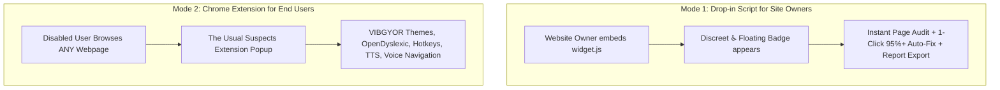

# The Usual Suspects - Accessibility Layer for Any Website
### Hackathon Problem Statement 1.4: Universal Web Accessibility Layer

> **Problem:** Most websites fail basic accessibility checks, which excludes visually impaired, dyslexic, and motor-impaired users.  
> **Target Users:** Small businesses, public-service portals, users with disabilities.  
> **Approach:** Dual-deployment accessibility solution:
> 1. **Drop-in JavaScript Widget (`widget.js`)**: A 1-line script for small business and public portal owners.
> 2. **Chrome Extension (Manifest V3)**: For disabled users to navigate any site across the web.
> **Bonus Twist:** One-click accessibility score compliance report for site owners.

---

## 🚀 Dual-Delivery Architecture



---

## ✨ Complete Feature Breakdown

### 1. 🛡️ Real-Time WCAG 2.1 AA Audit Scanner
* Evaluates active webpage DOM across 5 core categories (100 points total):
  * **🖼️ Non-Text Content (WCAG 1.1.1):** Checks image `alt` attributes and ARIA roles.
  * **📑 Headings & Landmarks (WCAG 1.3.1):** Verifies single `<h1>`, checks heading order, and detects landmark roles (`<main>`, `<nav>`).
  * **🏷️ Input & Control Identification (WCAG 4.1.2 & 3.3.2):** Validates accessible form labels and button names.
  * **🔍 Text Scaling & Zoom (WCAG 1.4.4):** Flags viewport zoom blocks (`user-scalable=no`, `maximum-scale=1.0`).
  * **♿ Screen Reader Readiness (WCAG 3.1.1):** Checks `<html lang="...">` pronunciation attributes and table headers.

### 2. ⚡ One-Click Auto-Fix (Boost to 95%+)
* Dynamically patches all detected accessibility violations in the live DOM in 1 second:
  * Injects descriptive `alt` and `aria-label` tags into images from file metadata.
  * Removes pinch-to-zoom viewport restrictions and enables scaling up to 5x.
  * Generates accessible labels for input fields and icon buttons.
  * Injects accessible primary `<h1>` and `role="main"` landmarks.
  * Sets correct `lang` attribute for screen reader speech engines.

### 3. 📄 Executive Site Owner Compliance Report (The Bonus Twist)
* Generates a printable, client-ready **Accessibility Compliance Certificate (HTML / Print to PDF)** with:
  * Domain URL, timestamp, overall score (0–100), and Grade (A/B/C/F).
  * WCAG 2.1 AA checklist with Pass/Fail status for every metric.
  * Certified stamp for small businesses, public portals, and regulatory compliance.

### 4. 🔤 Dyslexia Typography Engine
* **OpenDyslexic-Regular**: True heavy-bottom font that anchors letters against flipping or rotation.
* **OpenDyslexic-Bold**: True vector bolding preventing browser faux-bold blurring.
* Custom word-spacing (`0.28em`), letter-spacing (`0.12em`), and line-height (`2.0`).

### 5. 🎯 Motor-Impaired Keyboard Navigation & Focus Rings
* **High-Visibility Focus Rings**: Injects glowing 3.5px orange focus indicators (`:focus-visible`) for easy tab navigation without a mouse.
* **Skip to Main Content Link**: Keyboard-accessible shortcut at the top of the DOM jumping straight to `<main>`.
* **Universal Accessibility Hotkeys**:
  * `Alt + A`: Read selected text or active element aloud
  * `Alt + R`: Toggle Reading Ruler
  * `Alt + K`: Toggle High-Visibility Focus Rings
  * `Alt + C`: Auto-boost contrast on low-contrast elements
  * `Alt + V`: Start voice command navigation
  * `Alt + S`: Skip to main content

### 6. 📏 Visual Reading Ruler (ADHD & Dyslexia Guide)
* Floating tinted visual guide that tracks mouse movement across paragraphs, preventing line skipping.

### 7. 🌓 Automated Contrast Auto-Repair (WCAG 1.4.3)
* Calculates relative luminance between text and background.
* Automatically boosts contrast to meet the WCAG AA minimum 4.5:1 ratio.

### 8. 🎙️ Web Speech API Engine
* **Speech Synthesis (TTS):** Floating "🔊 Read" button on mouse selection + Full page reading.
* **Speech Recognition:** Hands-free voice navigation ("Open [link]", "Click [button]").

---

## 📁 Project Directory Structure

```
Track3-EQITECH-demo0/
├── frontend/                  # 🌟 Official Showcase & Landing Portal (interactive playground, audit, embed generator)
├── manifest.json              # Chrome Extension Manifest V3 configuration
├── popup.html                 # Extension Popup UI (themes, audit, fixes, report, motor tools)
├── popup.js                   # Extension background execution & DOM remediation logic
├── content.js                 # Injected content script (hotkeys, ruler, TTS, contrast, voice)
├── widget.js                  # 🌟 Standalone 1-Line Drop-in Widget for website owners
├── demo-site.html             # 🌟 Live Public Service Portal demo showcasing widget.js
├── fonts/                     # Bundled OpenDyslexic (.woff2 and .otf) fonts
└── README.md                  # Comprehensive Documentation
```

---

## 🧪 How to Test and Present (Demo Guide for Judges)

### Presentation Part 1: The Showcase & Landing Portal (`frontend/index.html`)
1. Open `frontend/index.html` directly in your browser.
2. Experience the **Dual-Delivery Hub**:
   * **Extension Connection Indicator**: Dynamically checks whether The Usual Suspects Chrome Extension is active in the user's browser.
   * **Interactive Accessibility Playground**: Test Dyslexia fonts (OpenDyslexic vector fonts), Bionic Reading, High-Contrast VIBGYOR themes, Visual Reading Ruler, Glowing Focus Rings, and Voice Commands.
   * **Real-Time WCAG 2.1 AA Audit Scanner & 1-Click Auto-Fix**: Run the live DOM scanner, click `⚡ Auto-Fix All Issues (95%+)`, and click `📄 Export Site Owner Compliance Report`.
   * **1-Line Embed Generator**: Test the real `widget.js` live on the page with a single switch.
   * **Direct Extension Download**: One-click download of the complete `the-usual-suspects-extension-v2.1.zip`.

### Presentation Part 2: The Drop-in Widget (For Site Owners / Small Businesses)
1. Open `demo-site.html` directly in Google Chrome.
2. Notice the floating **♿ accessibility badge** at the bottom right.
3. Click the badge to open the **The Usual Suspects Layer drawer**:
   * Click **`📊 Scan Page Score`** to see real-time compliance.
   * Click **`⚡ Auto-Fix All Issues (95%+)`** — watch the score jump to Grade A!
   * Click **`📄 Export Site Owner Compliance Report`** to generate the printable executive compliance certificate.
   * Toggle **Reading Ruler**, **Dyslexia Font**, or **Focus Rings**.

### Presentation Part 3: The Chrome Extension (For End Users Browsing Any Site)
1. Open Google Chrome and go to `chrome://extensions/`.
2. Enable **Developer mode** in the top right.
3. Click **Load unpacked** and select the `Track3-EQITECH-demo0` directory.
4. Navigate to any website (e.g., Wikipedia or a news portal).
5. Open the extension popup to test:
   * **Dyslexia Font** (OpenDyslexic with weighted baselines).
   * **Website Efficiency Audit & 1-Click Fix**.
   * **Reading Ruler (Alt+R)** and **Focus Rings (Alt+K)**.
   * **Selected Text-to-Speech** (highlight any paragraph to see the floating 🔊 Read button).
   * **Voice Navigation** ("Open Talk", "Click Help").